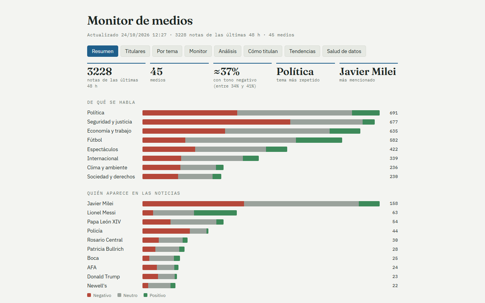
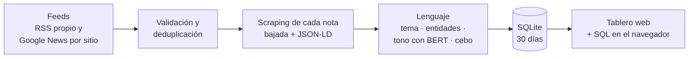

# Monitor de medios argentinos

**¿Cómo nos cuentan las noticias?** Un sistema automático que cada 30 minutos lee los titulares de
46 medios argentinos, entra a cada nota, clasifica de qué habla y con qué tono, y mide **cómo
titula cada medio**: cuánto exagera, cuánto busca el clic y cuánto firma lo que publica.

Trabajo práctico de **Web Mining** · Maestría en Ciencia de Datos.

**[Abrir el tablero](https://miguegarrone-blip.github.io/Web-Mining/)** · [Informe del TP](docs/informe-tp.docx) · [Presentación](docs/presentacion-tp.pptx)



## Qué preguntas responde

- ¿De qué se habla hoy y qué temas crecen respecto de lo habitual?
- ¿Qué medios cubren más un tema, una persona o una institución, y con qué tono?
- ¿Qué noticias cubre casi todo el ecosistema y cuáles son exclusivas de un medio?
- ¿Quién titula de forma más alarmista o con más recursos de clickbait?
- ¿Cuánto contenido está firmado por periodistas y cuánto sale como "Redacción"?

## Qué medios sigue

46 medios de tres alcances y cinco tipos:

| Alcance | Ejemplos |
|---|---|
| **Rosario** (7) | La Capital, Rosario3, El Ciudadano, Conclusión, Rosarioplus, Rosario Nuestro, Municipalidad de Rosario |
| **Nacional** (20) | Clarín, La Nación, Infobae, Página/12, Perfil, Ámbito, El Cronista, TN, C5N, A24, El Trece, Radio Mitre, Cadena 3 |
| **Interior** (19) | La Voz, Los Andes, La Gaceta, El Litoral, Río Negro, El Día, Misiones Online, Gobierno de Santa Fe |

Diarios, portales digitales, canales de TV, radios y dos fuentes oficiales.

## Cómo funciona



1. **Recolección.** Lee en paralelo los feeds RSS de los medios que los publican y, para el resto, la búsqueda de Google News restringida a cada sitio.
2. **Validación.** Descarta lo que no es una nota (videos, avisos fúnebres), las fechas imposibles y los duplicados. Cada nota se identifica por su URL canónica.
3. **Scraping de cada nota.** Decodifica los enlaces de Google News y entra a la página del medio para leer la **bajada** y el bloque **JSON-LD** `NewsArticle` que los diarios publican para los buscadores: autor, sección, palabras clave y largo del cuerpo.
4. **Procesamiento de lenguaje.**
   - **Tema:** reglas sobre título y bajada, más un Naive Bayes que aprende de lo que ya clasificaron las reglas.
   - **Entidades:** personas, instituciones y clubes del diccionario, más las que detecta **spaCy** (reconocimiento de entidades) aunque no estén en la lista.
   - **Tono:** si el hecho es bueno o malo para los involucrados. Combina palabras clave con **XLM-RoBERTa** (BERT).
   - **Cebo:** puntaje de clickbait de cada título.
   - **Embeddings de oraciones** (MiniLM multilingüe): para encontrar notas parecidas y buscar por significado.
5. **Almacenamiento.** SQLite con 30 días de histórico y exportación a CSV.
6. **Publicación.** Genera el tablero y lo publica junto con la base en GitHub Pages.

Todo corre solo cada 30 minutos en **GitHub Actions** (cada corrida programa la siguiente) y unas pruebas automáticas vigilan las funciones de extracción. La base se guarda comprimida en la rama `data-diarios`, así el repositorio no crece con los datos.

## Qué mide

| Indicador | Qué es |
|---|---|
| **Termómetro y resumen del día** | Un número de 0 a 100 con el % de notas negativas de las últimas 24 h, y un párrafo que resume la jornada armado automáticamente. |
| **Agenda** | Qué parte de sus notas dedica cada medio a cada tema, contra el promedio; temas y personas que crecen fuera de lo normal. |
| **Tono** | Porcentaje de notas negativas, neutras y positivas, corregido según los errores conocidos del modelo. |
| **Share of voice** | Cuánto aparece una persona o institución en cada medio y con qué tono. |
| **Tono por figura** | Cómo trata cada medio a cada figura (Milei, Kicillof, Messi…): % negativo contra el promedio de los medios. |
| **Encuadre** | La misma noticia contada por cada medio, lado a lado, con el tono y los recursos de cebo de cada título. |
| **Primicia** | Qué medio publica primero las historias que después cubren los demás. |
| **Mapa de medios** | Grafo de medios que cubren las mismas historias, con comunidades detectadas automáticamente. |
| **Figuras nuevas** | Personas e instituciones que aparecen hoy en varios medios y no estaban en la agenda de los días anteriores (spaCy). |
| **Notas parecidas** | Para cada titular, las notas de otros medios que cuentan lo mismo aunque usen otras palabras (similitud de embeddings). |
| **Exageración** | Títulos negativos cuya bajada, escrita por el mismo medio, no lo es. |
| **Cebo** | Títulos con preguntas, exclamaciones, adjetivos exagerados, intriga, segunda persona o listas. |
| **Transparencia** | Porcentaje de notas firmadas por un periodista. |
| **Clima mediático y dólar** | % de notas negativas por día junto al dólar blue, con su correlación cuando hay suficientes días. |
| **Salud de las fuentes** | Estado de cada feed y tasa de éxito del scraping por medio. |

## Algunos hallazgos

Con el primer día de histórico (24/10/2026, 5.302 notas), que todavía son preliminares:

- **A24** usa recursos de cebo en el 22% de sus títulos, seguido por El Destape y Radio Mitre (19%); Perfil y El Chubut, en menos del 2%.
- **Perfil** firma el 92% de sus notas; Radio Mitre, Rosario3 y Elonce no firman ninguna.
- En **Diario Chaco** la mitad de las notas tiene tono negativo; en **El Chubut**, una de cada cinco.
- La noticia más compartida (el sobreseimiento de Milei en la causa $Libra) la cubrieron 12 medios: la publicó primero **El Cronista** y el último llegó 8 horas después.
- El modelo de tono que combina palabras con BERT acierta un **77%**, contra 70% del modelo inicial, y detecta el **84% de las notas negativas**, contra 65%. Se midió con 340 titulares etiquetados a mano y validación cruzada.

## Cómo consultar los datos

- **Tablero:** https://miguegarrone-blip.github.io/Web-Mining/ tiene ocho pestañas: Resumen, Titulares, Por tema, Monitor, Análisis, Cómo titulan, Tendencias y Salud de datos.
- **SQL en el navegador:** el botón **Explorar la base (SQL)** abre la base en [Datasette Lite](https://lite.datasette.io/), sin instalar nada. Por ejemplo:
  ```sql
  SELECT medio, ROUND(100*AVG(cebo>=1), 1) AS pct_cebo
  FROM items GROUP BY medio HAVING COUNT(*) >= 50 ORDER BY pct_cebo DESC;
  ```
- **Descargas:** la base SQLite y un CSV para Excel o Power BI, desde el encabezado del tablero.
- **Búsqueda por significado:** en Titulares, el interruptor "Buscar por significado" carga el modelo en el navegador y ordena las notas por parecido con lo que escribís (por ejemplo, "suba de precios en los supermercados").
- **Notebook:** [`diarios-del-pais/analisis.ipynb`](diarios-del-pais/analisis.ipynb) reproduce los análisis principales con SQL y pandas (se ve ejecutado directamente en GitHub).

## Scraping responsable

- Respeta el `robots.txt` de cada sitio y se identifica con un User-Agent propio que enlaza a este proyecto.
- Hace como máximo 2 pedidos simultáneos por sitio y descarga cada nota una sola vez.
- No guarda ni publica el texto completo de las notas: solo título, bajada y metadatos, siempre con enlace al original.
- Los indicadores de exageración y cebo son mediciones automáticas con error conocido; sirven para comparar medios, no son un juicio sobre la calidad periodística de ninguno.

## Correrlo localmente

```bash
cd diarios-del-pais
pip install -r requirements.txt
pip install -r requirements-bert.txt   # opcional: tono con BERT
python build.py                        # genera historico.db, historico.csv y rosario.html
```

## Estructura del repositorio

| Ruta | Contenido |
|---|---|
| [`diarios-del-pais/`](diarios-del-pais/) | El pipeline: `build.py` orquesta; `enriquecer.py` scrapea las notas; `topics.py`, `nlp.py` y `bert.py` clasifican; `tpl2.html` es la plantilla del tablero; `analisis.ipynb` es el notebook de análisis. Detalle técnico en su [README](diarios-del-pais/README.md). |
| [`docs/`](docs/) | Informe del TP, presentación y los scripts que los generan. |
| [`.github/workflows/`](.github/workflows/diarios-del-pais.yml) | Automatización horaria con GitHub Actions. |

**Herramientas:** Python · requests · feedparser · googlenewsdecoder · SQLite · PyTorch y Hugging Face transformers (XLM-RoBERTa, MiniLM) · spaCy · transformers.js · scikit-learn · HTML, CSS y JavaScript sin frameworks · GitHub Actions · GitHub Pages · Datasette Lite.
